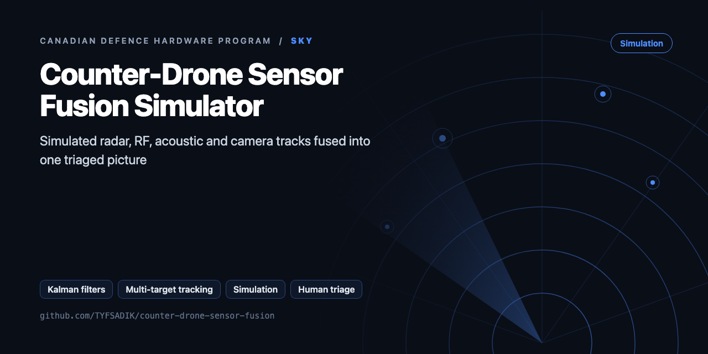
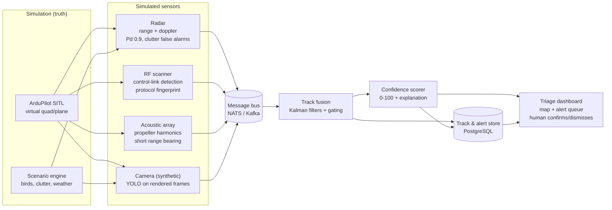

<div align="center">



# Counter-Drone Sensor Fusion Simulator

**Simulation-only defensive counter-drone project: synthetic radar, RF, acoustic, and camera tracks fused with Kalman filters, confidence-scored, human triaged.**

[](https://github.com/TYFSADIK/counter-drone-sensor-fusion/actions/workflows/tests.yml)   [](LICENSE) [](https://github.com/TYFSADIK/defence-hardware-program)

[Build guide](docs/project-page.md) · [How it works](#how-it-works) · [Quick start](#quick-start) · [Program hub](https://github.com/TYFSADIK/defence-hardware-program)

</div>

## Overview

Small drones are cheap, fast, and hard to see. Detecting them well takes more than one sensor: radar sees range and velocity but struggles with slow, low targets, RF scanners hear control links but only for known protocols, acoustic arrays hear propellers but only at short range, and cameras classify well but only in daylight and line of sight. This project builds a **sensor fusion simulator** that combines synthetic feeds from all four modalities into one track picture, so I can learn the hard part of counter-drone work: deciding what is real.

Everything is simulated. **ArduPilot SITL** (software in the loop) flies a virtual quadcopter on mission plans I write, and each simulated sensor observes that truth with its own noise model, detection probability, and false-alarm rate. There is no weapons logic anywhere in the system: the output is a scored, explainable alert on a dashboard, and a human operator decides what to do with it. Nothing here touches real RF spectrum, real airspace, or any classified technique.

Why build this: the interesting engineering in counter-UAS is not any single sensor, it is **false-positive management**. A flock of birds, a delivery drone on a legal route, and a genuine intruder can look identical to one sensor. Fusing weak signals into a confidence score, and being able to explain to an operator exactly why the score is what it is, is the problem this project practices.

## How it works



*Simulated truth, four noisy sensor models, a common bus, fusion, scoring, and the human triage loop.*

## Quick start

```bash
pip install -r requirements.txt
python demo.py && python -m unittest -v
```

Real output from the demo, run on simulated data:

```text
confirmed tracks: 2  (truth: 2 drones)
  D1: nearest track #1 error 12.3 m
  D2: nearest track #2 error 9.8 m
triage queue (human decides):
   {'track': 2, 'confidence': 0.853, 'class': 'UAV/multirotor', 'sensors': ['radar-1', 'rf-1'], 'range_m': 1169, 'closing_mps': 12.1, 'tta_s': 97, 'operator_decision': None}
   {'track': 1, 'confidence': 0.863, 'class': 'UAV/multirotor', 'sensors': ['radar-1', 'rf-1'], 'range_m': 1145, 'closing_mps': 11.5, 'tta_s': 100, 'operator_decision': None}
```

## What's in this repo

| File | Purpose |
|---|---|
| `fusion/models.py` | Constant-velocity 3D model, position and **bearing-only EKF** measurement models, angle-wrapped innovation |
| `fusion/tracker.py` | Multi-target tracker: χ² Mahalanobis gating, Hungarian GNN assignment, Joseph-form update, M-of-N confirmation, deletion. Bearing-only sensors refine tracks but never start them |
| `fusion/confidence.py` | Confidence from persistence, sensor diversity, NIS consistency, and covariance, plus a triage queue sorted by time-to-arrival |
| `fusion/synthetic.py` | Radar, EO, acoustic-bearing, and RF-bearing sensors with Pd, noise, and clutter, and two inbound drones |

## What you need

| Category | Item | Notes |
|----|----|----|
| Hardware | Any laptop or desktop | Simulation only; no RF hardware, no airframe, nothing transmits |
| Software | ArduPilot SITL, MAVProxy, Python, NumPy, filterpy, NATS, PostgreSQL, FastAPI, Leaflet, Docker Compose | All open source |
| Skills | Python, basic linear algebra for the Kalman predict/update loop, statistics intuition for detection probability and false-alarm rates | A Kalman background helps but filterpy carries the math; the tuning judgment is the real skill |
| Accounts | None | No keys, no feeds, no subscriptions; everything is generated locally |

## Status

- **Done**: architecture design, sensor model specifications, common detection schema, ArduPilot SITL environment running headless in Docker.
- **In progress**: radar sensor simulator with noise and clutter models, single-sensor Kalman tracker with gating, scenario replay harness.
- **Next**: tentative-track confirmation logic, RF and acoustic sensor models, multi-modal confidence scoring, then the triage dashboard and operator feedback loop.

## Roadmap

- [ ] **IMM** (constant-velocity + coordinated-turn + hover) for manoeuvring multirotors
- [ ] Feed confirmed tracks into `counter-drone-scoring-harness` (replace its naive `cluster()`) and report GOSPA
- [ ] Real inputs: bearings from `acoustic-drone-detector`, plots from `sky-passive-radar-node`, all via the `multi-domain-common-operating-picture` message bus
- [ ] Out-of-sequence measurement handling (sensors with different latencies)
- [ ] Log every operator decision to `decision-black-box`

## Related builds

- [Passive Acoustic Drone Detector](https://github.com/TYFSADIK/acoustic-drone-detector), the real MEMS microphone array build behind the acoustic channel in the simulation.
- [Passive Radar Node](https://github.com/TYFSADIK/sky-passive-radar-node), the real KrakenSDR radar build behind the radar channel in the simulation.
- [Multi-Domain Common Operating Picture](https://github.com/TYFSADIK/multi-domain-common-operating-picture), where fused tracks from every sensor end up on one operator dashboard.

## Learn more

The full build guide, with step-by-step instructions, wiring, troubleshooting and lessons learned, is in [docs/project-page.md](docs/project-page.md). It is also published at [tyfsadik.org](https://tyfsadik.org/work/defence/counter-drone-sensor-fusion.html).

## License

[MIT](LICENSE). Built by [Taki Sadik](https://tyfsadik.org) as part of the self-funded [Canadian Defence Hardware Program](https://github.com/TYFSADIK/defence-hardware-program).
