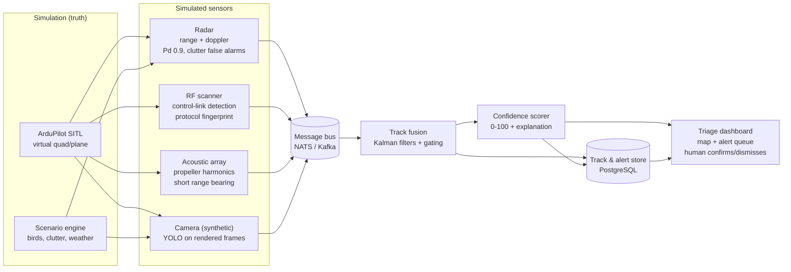
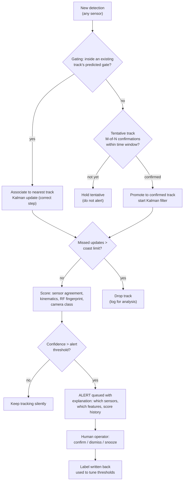

# Counter-Drone Sensor Fusion Simulator

Written by [Taki Sadik](https://tyfsadik.org/about.html) · Last updated 2026-10-22 · Status: Building · 15 min read

A simulation-only, strictly defensive project: synthetic radar, RF, acoustic, and camera tracks (ArduPilot SITL provides the drone flight dynamics) are fused with Kalman filters, every detection gets a confidence score, and alerts are triaged on a dashboard where a human always makes the final call.

## Overview

Small drones are cheap, fast, and hard to see. Detecting them well takes more than one sensor: radar sees range and velocity but struggles with slow, low targets, RF scanners hear control links but only for known protocols, acoustic arrays hear propellers but only at short range, and cameras classify well but only in daylight and line of sight. This project builds a **sensor fusion simulator** that combines synthetic feeds from all four modalities into one track picture, so I can learn the hard part of counter-drone work: deciding what is real.

Everything is simulated. **ArduPilot SITL** (software in the loop) flies a virtual quadcopter on mission plans I write, and each simulated sensor observes that truth with its own noise model, detection probability, and false-alarm rate. There is no weapons logic anywhere in the system: the output is a scored, explainable alert on a dashboard, and a human operator decides what to do with it. Nothing here touches real RF spectrum, real airspace, or any classified technique.

Why build this: the interesting engineering in counter-UAS is not any single sensor, it is **false-positive management**. A flock of birds, a delivery drone on a legal route, and a genuine intruder can look identical to one sensor. Fusing weak signals into a confidence score, and being able to explain to an operator exactly why the score is what it is, is the problem this project practices.

## Architecture

Figure 1: simulated truth, four noisy sensor models, a common bus, fusion, scoring, and the human triage loop.

ArduPilot SITL is the source of truth: I fly real mission plans (waypoints, loiters, terrain-following) against the actual ArduPilot flight stack, so the drone dynamics are realistic rather than scripted sine waves. Each sensor model reads the truth and produces noisy detections on its own cadence. A scenario engine injects confusers: bird tracks with bird-like kinematics, radar clutter, and background RF chatter, so the fusion layer always has false positives to fight. Every sensor publishes to a common detection model (`sensor_id, timestamp, position/bearing, velocity, features, detection_conf`) on the message bus, which is what makes the sensors swappable.

## Track Fusion and Confidence Scoring

Figure 2: the detection-to-alert lifecycle, with tentative tracks, Kalman gating, and human feedback.

- **Gating and association**: each confirmed track runs an extended Kalman filter (constant-velocity for now, constant-turn-rate next). A new detection is only associated if it falls inside the filter's predicted measurement gate (Mahalanobis distance), which is the first line of defence against clutter.
- **Tentative tracks**: a single radar hit or acoustic blip never alerts. A track must be confirmed by M-of-N detections within a time window before it can score high enough to reach the queue, which kills most single-sensor false positives at birth.
- **Confidence scoring**: the score combines sensor agreement (how many modalities see the same object), kinematics (does it move like a drone or a bird), RF fingerprint (known control-link protocol), and camera classification confidence. Every input to the score is shown to the operator, no black box.
- **Human in the loop**: the system never acts. It queues an alert with its evidence, and the operator's confirm/dismiss decision is written back as a labelled example for threshold tuning.

### How the Kalman filter fuses the sensors

The tracker runs the classic predict-and-update loop per track. Each cycle predicts the target's next state (position, velocity) from the motion model and grows the uncertainty, represented as a covariance matrix; then each sensor's measurement updates the estimate, pulling it toward the observation by an amount weighted by that sensor's noise model. A radar range measurement with tight noise pulls harder than a noisy acoustic bearing, and the filter knows this from each sensor's measurement model, not from hand-tuned weights. Gating uses the Mahalanobis distance: a detection only associates with a track if it falls inside the filter's predicted measurement gate, which is what keeps clutter from spawning phantom tracks. This is the design; the single-sensor tracker is still being tuned, and multi-sensor fusion has no measured results yet.

The textbook loop this implements is: predict the state (x = F x + B u) and its covariance (P = F P F^T + Q); then update with the Kalman gain K = P H^T (H P H^T + R)^-1, so the corrected state is x + K (z - H x) and the corrected covariance is (I - K H) P. A detection associates only when its squared Mahalanobis distance d^2 = (z - H x)^T S^-1 (z - H x) falls below the gate, where S = H P H^T + R; d^2 follows a chi-square distribution with degrees of freedom equal to the measurement dimension, so the 95 percent gate is 5.99 for a 2D position measurement and 7.815 for 3D. Gate size and the M-of-N confirmation window are the two tuning knobs, and both are still being tuned (targets, not measured results).

### Why passive sensing matters

Both real-world sensors this simulator models, the passive radar node and the acoustic drone detector, are passive on the sensing path: they detect reflections of someone else's broadcast transmitters or the sound of rotor harmonics, and the sensing front end emits nothing that reveals their own position. The reporting link is separate: the acoustic node reports over Wi-Fi MQTT and the radar node over its network socket, and those links do emit RF when they transmit. In a strict EMCON deployment the reporting link would be wired, store-and-forward, or duty-cycled; on the bench it stays on because the data has to get to the fusion layer. That is the NRC/DRDC direction in miniature: a detector that is hard to direction-find is a detector that survives. Simulation is where the fusion logic gets debugged, because real flight time is expensive and a simulator lets you replay the exact same scenario while you tune the gates and the M-of-N confirmation thresholds.

## Stack

| Layer | Technology | Why |
|----|----|----|
| Drone truth | ArduPilot SITL + MAVProxy | Real flight stack, realistic dynamics, scriptable missions |
| Sensor models | Python (NumPy) | Noise, Pd, and false-alarm models per modality |
| Message bus | NATS (Kafka as alternative) | Lightweight pub/sub, one subject per sensor |
| Fusion | Python + filterpy | Reference Kalman/EKF implementations, easy to instrument |
| Storage | PostgreSQL | Tracks, alerts, and operator labels in one queryable store |
| Dashboard | FastAPI + Leaflet | Live map, alert queue, and explanation panel |
| Orchestration | Docker Compose (homelab) | Whole sim reproducible with one compose up |

## How I'm Building It

### Step 01: SITL truth source

ArduPilot SITL runs headless in a container; MAVProxy scripts fly repeatable missions (approach, loiter, retreat) and the vehicle state is logged as ground truth for later scoring against what the sensors "saw".

### Step 02: Sensor simulators

Each modality is a small Python process that samples the truth on its own cadence, applies range-based detection probability, Gaussian measurement noise, and a configurable false-alarm rate, then publishes detections to the bus.

### Step 03: Fusion core

A tracker maintains tentative and confirmed tracks, runs gating and Kalman updates, and handles coasting and deletion. This is where most of the tuning lives: gate sizes, confirmation windows, coast limits.

### Step 04: Confidence scoring and explanation

Each confirmed track gets a 0-100 score assembled from named factors, and the dashboard shows the factor breakdown alongside the track so a human can audit why an alert fired.

### Step 05: Triage dashboard and feedback loop

A FastAPI + Leaflet UI shows the live picture and an alert queue. Operator decisions are stored as labels, and I replay recorded scenarios against new thresholds to measure false-positive rate changes before adopting them.

## How Defence Could Implement This

Counter-UAS is an active CAF and NORAD concern, from base defence to protecting deployed forces and critical infrastructure. A system like this maps onto that context honestly:

- **Same fusion, real sensors**: the architecture does not care whether a detection came from my Python noise model or a real radar, RF sensor, or acoustic array. An operational system would keep the gating, tracking, and scoring layers and swap the sensor connectors.
- **Layered detection for fixed sites**: CAF bases and critical infrastructure (the kind of sites Operation LENTUS deploys to support during domestic emergencies) need exactly this layered model: wide-area radar, RF cueing, and camera confirmation, fused into one picture so a small operations room is not watching four separate screens.
- **False-positive discipline as a requirement**: in a real operations centre, alarm fatigue is a security failure. The tentative-track and human-triage design here reflects how these systems actually have to work: detection and tracking can be automated, engagement authority cannot.
- **Explainability for after-action review**: every alert keeping its factor breakdown and score history means a false alarm can be diagnosed and the threshold change justified, which matters for DND procurement and audit culture.
- **Simulation for training and procurement**: a SITL-based simulator like this is legitimately useful to defence as a training and evaluation tool: operators can be trained, and vendor fusion engines can be benchmarked against recorded scenarios, without flying anything.

The deliberate boundary: this project stops at detection, tracking, and alerting. Anything beyond that (interdiction, jamming, kinetic response) is a separate, regulated domain that this simulator neither models nor enables.

1.  **Get SITL flying first.** Run `sim_vehicle.py -v ArduCopter` from the ArduPilot tree, connect MAVProxy, and fly one waypoint mission. Log the vehicle state; that log is your ground truth.
2.  **Simulate one sensor.** Write a radar model: sample truth at 1 Hz, apply range-based detection probability and Gaussian noise, add random clutter hits. Do not build all four sensors yet.
3.  **Build the tracker against that one sensor.** A Kalman filter with gating (filterpy gets you there quickly) plus a tentative-track rule. Get single-sensor tracking solid before fusing anything.
4.  **Record and replay.** Persist every detection so you can replay a scenario against new tracker parameters. Fusion tuning without replay is guesswork.
5.  **Add confusers before sensors.** Inject bird-like tracks (fast, erratic, low altitude) into the scenario engine early, so your scoring logic grows up fighting false positives instead of meeting them later.
6.  **Add a second modality.** An RF detector that only fires within range of a known-protocol drone is the easiest second sensor, and immediately shows why multi-modal agreement belongs in the score.
7.  **Score with named factors.** Build the confidence score as a sum of individually visible factors from day one; retrofitting explainability is painful.
8.  **Build the triage UI last.** A Leaflet map plus an alert queue is a weekend of FastAPI once the backend emits clean, scored, explained alerts.

**Legality and ethics:** this project is simulation-only. It transmits nothing, receives nothing from real spectrum, and flies nothing. Do not point real sensors at airspace without authorization, and note that in Canada jamming or otherwise interfering with any radio transmission (including drone control links) is illegal for civilians under the Radiocommunication Act. Detection and tracking in simulation is the safe, legal, and genuinely educational version.

## Status & Roadmap

- **Done**: architecture design, sensor model specifications, common detection schema, ArduPilot SITL environment running headless in Docker.
- **In progress**: radar sensor simulator with noise and clutter models, single-sensor Kalman tracker with gating, scenario replay harness.
- **Next**: tentative-track confirmation logic, RF and acoustic sensor models, multi-modal confidence scoring, then the triage dashboard and operator feedback loop.

### Designed vs Built vs Measured

| Subsystem | Designed | Built | Measured |
|----|----|----|----|
| Architecture and sensor model specifications | Yes | Yes | Not applicable |
| Common detection schema | Yes | Yes | Not applicable |
| ArduPilot SITL environment (headless, Docker) | Yes | Yes | Not applicable |
| Radar sensor simulator (noise + clutter models) | Yes | In progress | No measured results yet |
| Single-sensor Kalman tracker with gating | Yes | In progress | No measured results yet |
| Scenario replay harness | Yes | In progress | No measured results yet |
| Tentative-track confirmation (M-of-N) | Yes | No | No measured results yet |
| Multi-modal confidence scoring | Yes | No | No measured results yet |
| Triage dashboard and operator feedback | Yes | No | No measured results yet |

The SITL baseline, the design, and the schema exist. Radar simulation and the single-sensor tracker are in progress, and no fusion benchmark has been run, so every detection and scoring claim above is a design or a target.

## How I Built It

### Step 01: SITL truth source

ArduPilot SITL runs headless in a Docker container; MAVProxy scripts fly repeatable missions (approach, loiter, retreat). Vehicle state is logged as ground truth, so later I can score what the simulated sensors saw against what actually happened.

### Step 02: Common detection schema

Every sensor publishes (sensor_id, timestamp, position/bearing, velocity, features, detection_conf) to the bus (NATS, with Kafka as an alternative). Swappable sensors are a schema decision, not a code one: anything that speaks the schema can join.

### Step 03: Radar sensor simulator (in progress)

A Python process samples the truth at its own cadence, applies range-based detection probability, Gaussian measurement noise, and a configurable false-alarm rate, then adds clutter hits. One sensor done well before four sensors done badly.

### Step 04: Single-sensor tracker (in progress)

A Kalman filter with Mahalanobis gating built on filterpy, plus a scenario replay harness that persists every detection. Recorded scenarios replay against new tracker parameters, so tuning is measurement instead of guesswork.

### Step 05: Confusers and confirmation (next)

Bird-like tracks with bird kinematics, radar clutter, and background RF chatter go into the scenario engine, and M-of-N tentative-track confirmation decides which tracks are allowed to alert.

### Step 06: Scoring, triage, and feedback (next)

Multi-modal confidence score assembled from named factors, a FastAPI plus Leaflet triage dashboard showing the factor breakdown, and operator confirm/dismiss decisions written back as labels for threshold tuning.

## What You Need

| Category | Item | Notes |
|----|----|----|
| Hardware | Any laptop or desktop | Simulation only; no RF hardware, no airframe, nothing transmits |
| Software | ArduPilot SITL, MAVProxy, Python, NumPy, filterpy, NATS, PostgreSQL, FastAPI, Leaflet, Docker Compose | All open source |
| Skills | Python, basic linear algebra for the Kalman predict/update loop, statistics intuition for detection probability and false-alarm rates | A Kalman background helps but filterpy carries the math; the tuning judgment is the real skill |
| Accounts | None | No keys, no feeds, no subscriptions; everything is generated locally |

## Challenges and Lessons Learned

- **Clutter association is the whole problem.** A detection only joins a track if it falls inside the filter's predicted measurement gate (Mahalanobis distance). That gate is the first line of defence against phantom tracks, and its size is the most-tuned parameter in the system.
- **Single-sensor hits never alert.** M-of-N confirmation within a time window kills most false positives at birth, which is where bird tracks, clutter hits, and acoustic blips die. A single radar hit is a rumor, not a track.
- **Sensor cadences differ, so the schema carries time.** Each sensor publishes on its own cadence with its own timestamps. Fusion reads time, not arrival order, which is what makes the sensors genuinely swappable.
- **Explainability has to be designed in.** The confidence score is a sum of individually visible factors from day one: sensor agreement, kinematics, RF fingerprint, camera class. Retrofitting explainability after the scorer exists is painful.
- **Replay before tuning.** The scenario replay harness comes before the second sensor, because fusion parameters tuned without recorded scenarios are guesswork. Every threshold change replays against the same scenarios so the false-positive rate is measured, not felt.

## What Is Next

- Tentative-track confirmation logic (M-of-N), then the RF and acoustic sensor models.
- Multi-modal confidence scoring with the explanation panel.
- Triage dashboard and the operator feedback loop.
- Publish false-positive rates per recorded scenario as measured results. Until then, detection and scoring claims on this page are designs and targets.

## Related Builds

- [Passive Acoustic Drone Detector](https://github.com/TYFSADIK/acoustic-drone-detector), the real MEMS microphone array build behind the acoustic channel in the simulation.
- [Passive Radar Node](https://github.com/TYFSADIK/sky-passive-radar-node), the real KrakenSDR radar build behind the radar channel in the simulation.
- [Multi-Domain Common Operating Picture](https://github.com/TYFSADIK/multi-domain-common-operating-picture), where fused tracks from every sensor end up on one operator dashboard.

## Cite This Page

**Plain text**

    Taki Sadik, "Counter-Drone Sensor Fusion Simulator", TYFSADIK, https://github.com/TYFSADIK/counter-drone-sensor-fusion (accessed 2026-10-22).

**BibTeX**

    @misc{sadik-counter-drone-sensor-fusion,
      author  = {Sadik, MD. Taki Yasir Faraji},
      title   = {Counter-Drone Sensor Fusion Simulator},
      year    = {2026},
      url     = {https://github.com/TYFSADIK/counter-drone-sensor-fusion},
      urldate = {2026-10-22}
    }

**APA**

    Sadik, M. T. Y. F. (2026). Counter-Drone Sensor Fusion Simulator. TYFSADIK. https://github.com/TYFSADIK/counter-drone-sensor-fusion

---

Original page: <https://github.com/TYFSADIK/counter-drone-sensor-fusion>
